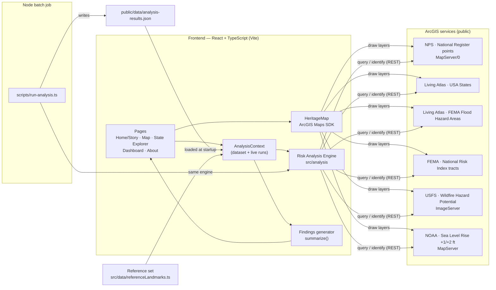

# Heritage at Risk

**Which historic landmarks could be underwater or burned by 2050?**

Heritage at Risk is an interactive GIS storytelling application that overlays America's historic places with federal flood, sea‑level‑rise, wildfire and coastal‑risk data, scores every landmark, and turns the results into plain‑language findings. Pick a state and you immediately see which historic places are threatened, how badly, and why.

Built with **React + TypeScript**, the **ArcGIS Maps SDK for JavaScript**, and public **ArcGIS Living Atlas / federal ArcGIS REST services**.

---

## Table of contents

1. [Project overview](#1-project-overview)
2. [Features](#2-features)
3. [Architecture diagram](#3-architecture-diagram)
4. [Folder structure](#4-folder-structure)
5. [Installation guide](#5-installation-guide)
6. [ArcGIS integration](#6-arcgis-integration)
7. [Spatial analysis workflow](#7-spatial-analysis-workflow)
8. [User guide](#8-user-guide)
9. [Data sources](#9-data-sources)
10. [Future improvements](#10-future-improvements)
11. [Final verification checklist](#final-verification-checklist)

Related documents: [DEVELOPER_GUIDE.md](DEVELOPER_GUIDE.md) · [GIT_WORKFLOW.md](GIT_WORKFLOW.md)

---

## 1. Project overview

### Purpose
Historic places are irreplaceable, yet most climate‑hazard planning focuses on homes and infrastructure. This project puts cultural heritage back into the data: it measures each landmark's exposure to climate hazards and explains the result in terms a community member or a judge can follow.

### Goals
- Identify historic landmarks exposed to flooding, sea‑level rise, wildfire and coastal‑flood risk, state by state.
- Explain **why** each landmark is threatened, with traceable evidence for every hazard.
- Rank landmarks so preservation effort can be prioritized.
- Generate findings automatically, so the app is a research tool, not just a map.

### Research question
> **Which historic landmarks could be underwater or burned by 2050?**

- **Underwater** = elevated or severe exposure to a FEMA flood zone, NOAA's projected +1 ft / +2 ft high‑tide inundation, or high FEMA National Risk Index coastal‑flood risk.
- **Burned** = high or very high USDA Forest Service Wildfire Hazard Potential.
- **2050** = NOAA's 2022 Sea Level Rise Technical Report projects 10–12 inches of rise along U.S. coasts between 2020 and 2050, so the +1 ft scenario represents the likely 2050 condition and +2 ft the high‑end case.

### Expected outcomes
- A ranked, evidence‑backed list of threatened landmarks for every state.
- National findings such as "*X historic sites are at risk from flooding*", "*Y intersect projected sea‑level‑rise zones*", "*Florida and Louisiana contain the highest concentration of threatened sites*", "*Z locations face both flooding and wildfire risk*" — generated from the data, never hard‑coded.
- A documented, reproducible method that others can audit or extend.

---

## 2. Features

| Feature | What it does | Where |
|---|---|---|
| **Interactive map** | ArcGIS MapView with landmarks colored by risk class; toggleable FEMA flood, NOAA sea‑level‑rise, USFS wildfire and FEMA NRI coastal layers; search, legend, home button; filter by risk class or hazard; click a landmark for its evidence or a state to zoom. | `#/map` |
| **State Explorer** | Choose a state from the dropdown or by clicking the map. See summary statistics, state findings, a ranked landmark list with expandable evidence, and a state map. **Run the live GIS analysis** on every National Historic Landmark (or every National Register listing) in that state. | `#/explore/XX` |
| **Risk Analysis Engine** | Intersects each landmark point with every hazard layer, converts results to 0–3 severities, computes a 0–100 score, and assigns **Low / Moderate / High / Critical**. Detects multi‑hazard exposure and applies a community‑resilience adjustment. Runs in the browser and in Node. | `src/analysis/` |
| **Findings Dashboard** | Stat tiles, auto‑generated findings, charts of threatened landmarks by state and by hazard, risk‑class distribution, multi‑hazard counts, and the Top 10 most vulnerable landmarks. Every chart has a table view. | `#/dashboard` |
| **Story Mode** | The home page tells the story: why heritage matters, why preservation matters, four ways climate reaches a landmark, what the analysis found, case files, recommendations, and future considerations. All numbers are live. | `#/` |
| **About the Data / Project** | Datasets, service URLs, method, scoring tables, limitations; project purpose, goals and team. | `#/data`, `#/about` |
| **Dark & light mode** | Toggle in the header; remembers the choice; follows the OS by default. Map basemap and widget theme switch too. | header |
| **Responsive & accessible** | Mobile layouts, keyboard focus styles, skip link, ARIA labels, color never used alone, reduced‑motion support. | everywhere |

### Two kinds of evidence
The app always labels which evidence you are seeing:

1. **Reference set** (bundled, works offline): 33 historic places whose climate threats are documented by published assessments (e.g., the Union of Concerned Scientists' *National Landmarks at Risk*, NPS vulnerability studies) or by recent disasters (Lahaina 2023, Sperry Chalet 2017, Ellicott City 2016/2018). Every documented hazard cites its source.
2. **GIS analysis**: the Risk Analysis Engine intersects landmark coordinates with live hazard services — either per state in the browser (State Explorer) or nationally with `npm run analyze`, which writes `public/data/analysis-results.json`. When that file exists, the app uses it automatically.

---

## 3. Architecture diagram



### Data flow (ASCII)

```
            ┌──────────────── startup ────────────────┐
            │ fetch data/analysis-results.json         │
            │   found → mode "national-gis"            │
            │   missing → mode "reference" (bundled)   │
            └───────────────────┬─────────────────────┘
                                ▼
 State Explorer "Analyze" ─► loadLandmarksForState ─► assessLandmark × N ─► merge into context
                                │                        │ NRI tract query    (FEMA NRI)
                                │                        │ flood-zone query   (FEMA NFHL)
                                │                        │ raster identify    (USFS WHP)
                                │                        └ raster identify    (NOAA SLR, coastal only)
                                ▼
                 assessments ─► summarize() ─► Dashboard · Story · Map · Findings text
```

---

## 4. Folder structure

```
Tech-Expo/
├── index.html                 # HTML shell: fonts, ArcGIS widget theme, no-flash theme script
├── package.json               # Scripts and dependencies
├── tsconfig.json              # TypeScript settings (strict)
├── vite.config.ts             # Vite build config (relative base for static hosting)
├── .env.example               # Optional environment variables (copy to .env.local)
├── README.md                  # This file
├── DEVELOPER_GUIDE.md         # How the code works and how to extend it
├── GIT_WORKFLOW.md            # Branching, commits, pull requests
├── public/
│   ├── favicon.svg            # App icon
│   └── data/
│       └── README.md          # Where analysis-results.json goes (created by npm run analyze)
├── scripts/
│   └── run-analysis.ts        # Node CLI: national/state batch analysis → JSON
└── src/
    ├── main.tsx               # Entry point; mounts <App/>
    ├── App.tsx                # Providers, header/footer, hash router, lazy map pages
    ├── config/
    │   ├── appConfig.ts       # Env vars (browser + Node), constants
    │   ├── layers.ts          # ★ All service URLs, hazard layer configs, field names
    │   ├── palette.ts         # Colors needed in JS (map renderers)
    │   └── states.ts          # 50 states + DC, coastal flag, fallback map views
    ├── types/
    │   ├── landmark.ts        # Landmark
    │   ├── hazard.ts          # HazardId, Severity, HazardExposure
    │   └── analysis.ts        # RiskAssessment, RiskClass, FindingsSummary, …
    ├── analysis/              # ★ Risk Analysis Engine (pure TypeScript, no UI)
    │   ├── arcgisRest.ts      # fetch wrappers: query, identify, paging, concurrency pool
    │   ├── geometry.ts        # point-in-polygon, bounding boxes, haversine
    │   ├── landmarkSource.ts  # Load NRHP landmarks; assign states (state filtering)
    │   ├── hazardProbes.ts    # One probe per hazard → HazardExposure
    │   ├── riskScoring.ts     # Severity mappings, score, classification, reasons
    │   ├── riskEngine.ts      # Orchestration: assessLandmark / analyzeState
    │   ├── findings.ts        # Aggregation + auto-generated findings sentences
    │   └── __tests__/         # node:test unit tests (run with npm test)
    ├── data/
    │   └── referenceLandmarks.ts  # Curated, cited reference set (33 places)
    ├── context/
    │   ├── AnalysisContext.tsx    # Dataset mode, live runs, summary (single source of truth)
    │   └── ThemeContext.tsx       # Light/dark mode
    ├── hooks/
    │   └── useHashRoute.ts    # Minimal hash router
    ├── components/
    │   ├── layout/            # Header (nav, theme toggle), Footer
    │   ├── map/               # HeritageMap (ArcGIS), mapLayers (layer factory), LayerPanel
    │   ├── charts/            # ChartFrame, BarChart, SegmentedBar, StatTile
    │   ├── landmarks/         # LandmarkList (+ EvidenceTable), RiskBadge, HazardChips
    │   ├── findings/          # FindingsList
    │   └── common/            # StateSelect, DatasetBanner, ProgressBar
    ├── pages/                 # HomePage (Story), MapPage, StateExplorerPage,
    │                          # DashboardPage, AboutDataPage, AboutProjectPage
    └── styles/
        ├── global.css         # Design tokens (light/dark), base, header, buttons, fields
        └── components.css     # Component and page styles
```

---

## 5. Installation guide

### Prerequisites
- **Node.js 20.19+** (or 22.12+) and npm 10+ — check with `node -v`
- **Git**
- A modern browser (Chrome, Edge, Firefox, Safari)
- Internet access (the map and live analysis call public ArcGIS services)
- *Optional:* an ArcGIS Location Platform API key (not required)

### Setup
```bash
git clone https://github.com/fgamboa-stars/Tech-Expo.git
cd Tech-Expo
git checkout TestOne        # all project work lives on this branch
npm install
```

### Running locally
```bash
npm run dev                 # starts Vite at http://localhost:5173
```
Open the URL, then try `#/explore/FL` or the **Interactive map**.

Other scripts:

| Command | Purpose |
|---|---|
| `npm test` | Run the analysis unit tests (offline, uses mocked services) |
| `npm run typecheck` | TypeScript type check |
| `npm run analyze` | National batch analysis of all National Historic Landmarks → `public/data/analysis-results.json` (≈15–30 min) |
| `npm run analyze -- --state LA` | Analyze one state and merge into the results file |
| `npm run analyze -- --state CA --scope all --limit 800` | All National Register listings in a state, capped |
| `npm run build` | Production build into `dist/` |
| `npm run preview` | Serve the production build locally |

### Environment variables
All are optional. Copy `.env.example` to `.env.local`:

| Variable | Default | Purpose |
|---|---|---|
| `VITE_ARCGIS_API_KEY` | *(empty)* | ArcGIS API key for basemap styles; public basemaps work without it |
| `VITE_NRHP_URL` | NPS NRHP points | Override the landmark service |
| `VITE_STATES_URL` | Living Atlas states | Override state boundaries |
| `VITE_FEMA_FLOOD_URL` | Living Atlas FEMA flood | Override the flood layer |
| `VITE_NRI_TRACTS_URL` | FEMA NRI tracts | Override the NRI layer |
| `VITE_WHP_URL` | USFS WHP 2023 | Override the wildfire raster |
| `VITE_SLR_BASE_URL` | NOAA `slr_{ft}ft` | Override the sea‑level services (`{ft}` is replaced) |
| `VITE_ANALYSIS_CONCURRENCY` | `6` | Max parallel requests in the browser |

The Node script reads the same variables from the shell environment.

### Building for production
```bash
npm run analyze             # optional but recommended before an expo: bakes in national results
npm run build               # outputs static files to dist/
npm run preview             # sanity-check the build at http://localhost:4173
```
`dist/` is a fully static site (relative paths + hash routing), so it can be hosted anywhere:

- **GitHub Pages:** push `dist/` to a `gh-pages` branch (e.g., `npx gh-pages -d dist`) and enable Pages for that branch.
- **Netlify / Vercel:** build command `npm run build`, publish directory `dist`.
- **Expo laptop:** `npm run preview` (or open `dist/` with any static server). The reference set and findings work even if Wi‑Fi drops; the map needs internet.

---

## 6. ArcGIS integration

### How Living Atlas and federal layers are connected
All layers are defined once in [`src/config/layers.ts`](src/config/layers.ts). Two consumers read that file:

1. **The map** ([`components/map/mapLayers.ts`](src/components/map/mapLayers.ts)) turns each config into an ArcGIS SDK layer:
   - `FeatureLayer` — FEMA flood zones, FEMA NRI tracts (custom renderer on `CFLD_RISKR`), USA States, NRHP points, and a client‑side layer of analyzed landmarks built from `Graphic`s.
   - `ImageryLayer` — USFS Wildfire Hazard Potential.
   - `MapImageLayer` — NOAA sea‑level‑rise inundation.
2. **The analysis engine** ([`src/analysis`](src/analysis)) calls the same services' REST endpoints directly with `fetch` (`/query`, `/identify`), so it runs in both the browser and Node.

### Service URLs

| Layer | URL |
|---|---|
| NRHP points (NPS) | `https://mapservices.nps.gov/arcgis/rest/services/cultural_resources/nrhp_locations/MapServer/0` |
| USA States Generalized (Living Atlas) | `https://services.arcgis.com/P3ePLMYs2RVChkJx/arcgis/rest/services/USA_States_Generalized_Boundaries/FeatureServer/0` |
| USA Flood Hazard Areas (FEMA NFHL via Living Atlas) | `https://services.arcgis.com/P3ePLMYs2RVChkJx/arcgis/rest/services/USA_Flood_Hazard_Reduced_Set_gdb/FeatureServer/0` |
| National Risk Index, census tracts (FEMA) | `https://services.arcgis.com/XG15cJAlne2vxtgt/arcgis/rest/services/National_Risk_Index_Census_Tracts/FeatureServer/0` |
| Wildfire Hazard Potential 2023 classified (USFS) | `https://apps.fs.usda.gov/fsgisx01/rest/services/RDW_Wildfire/RMRS_WildfireHazardPotential_Classified_2023/ImageServer` |
| Sea Level Rise +1 ft / +2 ft (NOAA OCM) | `https://coast.noaa.gov/arcgis/rest/services/dc_slr/slr_1ft/MapServer`, `…/slr_2ft/MapServer` |
| Basemaps | `gray-vector` (light) / `dark-gray-vector` (dark) via `Basemap.fromId` |
| Widget theme CSS | `https://js.arcgis.com/4.34/esri/themes/{light|dark}/main.css` |

> Agencies occasionally move services. If a layer shows **unavailable** in the layer panel, find the current URL in ArcGIS Living Atlas or the agency's REST directory and set the matching `VITE_*` variable — no code changes needed.

### Authentication requirements
- **None for the data.** Every service above is public.
- **Basemaps:** work without a key for development and demos. For production traffic, create an API key in ArcGIS Location Platform and set `VITE_ARCGIS_API_KEY`; `HeritageMap.tsx` assigns it to `esriConfig.apiKey`.
- Never commit `.env.local` (it is git‑ignored).

### Layer configuration
Each hazard is a `HazardLayerConfig` entry:

```ts
{
  id: "wildfire",                 // HazardId used everywhere (colors, charts, filters)
  label: "Wildfire hazard",
  description: "…",               // shown in the layer panel
  publisher: "USDA Forest Service, Wildfire Hazard Potential 2023",
  analysisUrl: WHP_URL,           // what the engine queries
  mapUrl: WHP_URL,                // what the map draws
  mapLayerType: "imagery",        // "feature" | "imagery" | "map-image"
  defaultVisible: true,
  opacity: 0.45,
}
```
Field names the engine reads (`FLD_ZONE`, `CFLD_RISKR`, `RESL_RATNG`, `RESNAME`, `Is_NHL`, …) are in the `FIELDS` constant in the same file.

---

## 7. Spatial analysis workflow

1. **Data acquisition** — `landmarkSource.ts` downloads the 51 generalized state polygons once (simplified to ~1 km with `maxAllowableOffset`). For a state, it queries NRHP points inside the state's bounding box (`Is_NHL = 'X'` for National Historic Landmarks), paging past the service's record limit, then keeps only points that fall inside the state polygon (ray‑casting point‑in‑polygon in `geometry.ts`). Points cut off by a generalized coastline snap to the nearest state.
2. **Layer loading** — the map builds layers from `HAZARD_LAYERS`; the engine reads the same URLs. Layer load status is shown in the panel.
3. **Spatial intersections** (per landmark, `hazardProbes.ts`):
   - **FEMA flood:** `/query` with the point geometry and `spatialRel=esriSpatialRelIntersects` → zone polygons containing the landmark; the most severe zone wins.
   - **NRI tract:** same point query on census tracts → coastal‑flood rating, resilience rating (plus wildfire and riverine ratings as context).
   - **Wildfire:** ImageServer `/identify` → WHP class of the 270 m cell.
   - **Sea‑level rise:** only if the tract or flood zone is coastal. MapServer `/identify` on the +2 ft service; if wet, also +1 ft. "Low‑lying, unconnected" layers are ignored.
   - A failed request is recorded as **not assessed** (`severity: null`), never as "safe".
4. **Risk calculations** (`riskScoring.ts`):

   | Hazard | Severe (3) | Elevated (2) | Low (1) | Weight |
   |---|---|---|---|---|
   | FEMA flood | V/VE | A, AE, AH, AO, AR, A99 | 0.2% / levee | 1.0 |
   | Sea‑level rise | wet at +1 ft | wet at +2 ft only | — | 1.2 |
   | Wildfire (WHP) | very high (5) | high (4) | moderate (3) | 1.0 |
   | Coastal (NRI) | very high | relatively high | relatively moderate | 0.8 |

   `score = 100 × Σ(w·s) / Σ(w·3) × resilience factor (1.00–1.10) + 8 × (elevated hazards − 1)`, capped at 100.
   **Critical**: score ≥ 55 *or* a severe hazard plus another elevated one · **High**: score ≥ 35 *or* any severe hazard · **Moderate**: score ≥ 15 *or* any elevated hazard · **Low**: otherwise. Moderate and above = *threatened*.
5. **Output generation** — `findings.ts` aggregates counts by class, hazard and state, multi‑hazard and water‑and‑fire overlaps, the Top 10, and writes the findings sentences. The browser shows them immediately; the CLI writes them to `public/data/analysis-results.json` and prints them.

---

## 8. User guide

### State selection
- **State Explorer → State** dropdown (each option shows its threatened count), or click a state on any map, or open `#/explore/TX` directly.
- Press **Analyze [State]** to run the live GIS analysis. Choose *National Historic Landmarks* (fast) or *All National Register listings* (slow; use the **Maximum** box to cap). A progress bar shows each landmark tested; **Stop analysis** cancels safely.

### Layer filtering
- **Interactive map → Hazard layers:** turn FEMA flood zones (visible when zoomed in to city scale), sea‑level rise, wildfire hazard and coastal flood risk on or off. "unavailable" means the service did not respond.
- **Landmarks:** check or uncheck risk classes (counts shown), or show only landmarks with an elevated value for one hazard.
- **Search** (top right) finds any address or place; **Legend** (bottom left) explains symbols.

### Dashboard usage
- Use **Show** to switch between all states and one state.
- Stat tiles give headline counts; **Key findings** are generated from the data.
- Each chart has a **Table** button for exact numbers; state bars link to the State Explorer.
- Open any **Top 10** row to see the hazard‑by‑hazard evidence.

### Findings interpretation
- **Threatened** means Moderate or worse: at least one hazard at elevated level.
- **Could be underwater** counts landmarks with an elevated water hazard (flood zone, projected sea‑level rise, or high coastal‑flood community risk) — not that the building will be submerged permanently.
- **Could burn** counts landmarks in high or very high wildfire hazard areas — a measure of how hard a fire would be to control, not a prediction of a fire.
- Check the banner: **Reference set** numbers describe documented cases (not national rates); **GIS analysis** numbers are measured against every landmark analyzed.
- This is a screening tool for education and planning conversations, not an engineering or insurance assessment.

---

## 9. Data sources

| Dataset | Publisher | Used for |
|---|---|---|
| National Register of Historic Places — points | National Park Service | Landmark locations, names, NHL status |
| USA States Generalized Boundaries | Esri ArcGIS Living Atlas (U.S. Census Bureau) | State assignment and selection |
| USA Flood Hazard Areas (National Flood Hazard Layer) | FEMA, via ArcGIS Living Atlas | Flood‑zone intersection |
| Sea Level Rise Viewer inundation, +1 ft and +2 ft | NOAA Office for Coastal Management | Projected high‑tide inundation |
| Wildfire Hazard Potential, 2023 classified | USDA Forest Service, Fire Modeling Institute | Wildfire hazard class |
| National Risk Index — census tracts | FEMA | Coastal‑flood risk, community resilience |
| 2022 Sea Level Rise Technical Report | NOAA and interagency task force | 2050 scenario framing (10–12 in. average U.S. rise) |
| *National Landmarks at Risk* (2014) | Union of Concerned Scientists | Reference‑set evidence |
| NPS park climate pages and case studies (Fort Pulaski, Dry Tortugas) | National Park Service | Reference‑set evidence |
| News and institutional reports (Vizcaya, Ellicott City, Sperry Chalet, Big Basin, Lahaina) | Cited per landmark in `referenceLandmarks.ts` | Reference‑set evidence |

---

## 10. Future improvements
- **Additional hazard layers:** extreme heat, riverine flood projections (First Street, USGS), landslide, permafrost thaw for Alaska.
- **Forecast time slider:** compare 2030 / 2050 / 2100 using NOAA's 1–10 ft scenarios.
- **Polygon footprints:** use NRHP boundary polygons so districts and parks are measured by area exposed, not one point.
- **AI‑generated reports:** one‑page briefs per landmark or state for preservation officers.
- **Export options:** CSV/GeoJSON of results, printable PDF state reports, shareable map links with filters.
- **Storm surge:** add NOAA SLOSH hurricane surge zones.
- **Caching:** store live state results in IndexedDB between visits.

---

## Final verification checklist

✓ Development completed on TestOne branch
✓ README.md created
✓ DEVELOPER_GUIDE.md created
✓ GIT_WORKFLOW.md created
✓ Code comments added throughout
✓ JSDoc documentation added
✓ ArcGIS integration documented
✓ Spatial analysis workflow documented
✓ Risk scoring documented
✓ Learning Notes included
✓ State Explorer implemented
✓ Interactive map implemented
✓ Risk Analysis Engine implemented
✓ Findings Dashboard implemented
✓ Story Mode implemented
✓ Mobile responsive design implemented
✓ Dark mode implemented
✓ Light mode implemented
✓ Project folder structure provided
✓ Deployment instructions provided
